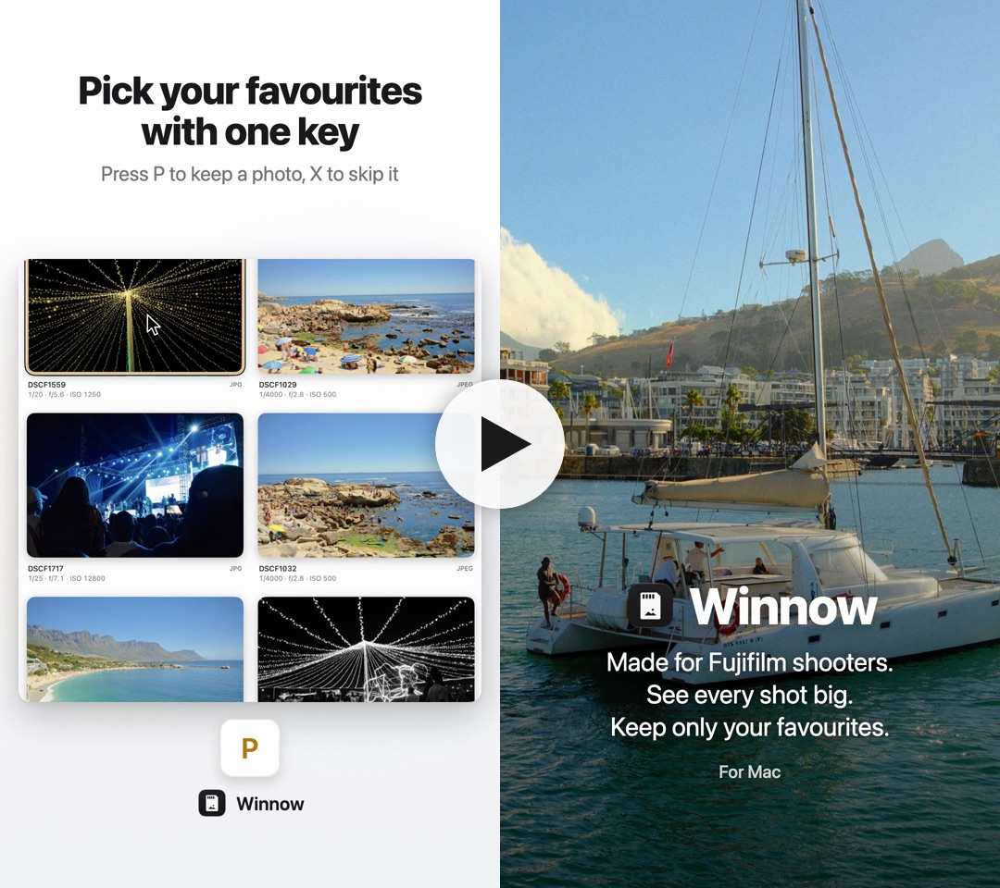

<p align="center">
  
</p>

<h1 align="center">Winnow</h1>

<p align="center">
  <b>Pick your best Fujifilm shots straight off the SD card, then import only those.</b><br>
  A native Mac app for macOS Tahoe.
</p>

<p align="center">
  <a href="https://github.com/makayi/Winnow/releases/latest"><b>⬇︎ Download Winnow for Mac</b></a><br>
  <sub>macOS 26 or later · Apple silicon · signed and notarized by Apple</sub>
</p>

<p align="center">
  <a href="https://github.com/makayi/Winnow/releases/latest/download/winnow-demo.mp4">
    
  </a><br>
  <sub>▶︎ Watch the 34-second demo</sub>
</p>

---

You shoot 400 frames and want maybe 20. Winnow is for the step in between: choosing those 20 before anything leaves the card.

It opens your card the moment you insert it and shows every shot big. Pick the keepers with one key, then copy only those, RAF and JPG together, into your own folders, ready to edit in Lightroom or anything else. There's no library to import into or export from, and every copy is checked against the card before anything is deleted.

## Features

- **Big previews, straight off the card.** Thumbnails up to 420 pt wide, resizable with a slider or ⌘= / ⌘-. Nothing is imported until you say so.
- **RAF + JPG as one photo.** Pairs are grouped automatically, and RAF-only and JPG-only shooting both work.
- **One-key culling.** P to pick, X to reject, U to clear, arrow keys to move. Flags are saved per card, so they survive ejecting and reinserting it.
- **A large view for the close calls.** Fit or 100% (decoded from the RAF when there is one), a filmstrip, and the shutter, aperture, ISO, focal length, lens and **Fujifilm film simulation** for every shot.
- **Verified import.** Copy into folders by date, by card folder, or all in one, with RAF + JPG, RAF only or JPG only. Every file is checked with a SHA-256 hash against the card before it's kept.
- **Free up your card safely.** After an import, Winnow offers to delete only the photos it copied and verified, plus your rejects if you tick the box. It never formats the card or touches anything else on it.
- **Made for the Mac.** Native SwiftUI with Apple's Liquid Glass and light and dark mode. Updates itself with [Sparkle](https://sparkle-project.org), its only dependency.

## Keyboard

| Key | Action |
|---|---|
| P / X / U | Pick / reject / clear |
| Space or Return | View large; Space again goes back to the grid |
| ← → | Previous / next photo |
| ↑ ↓ | Move by row in the grid |
| Z | Fit / 100% in the large view |
| Esc | Back to the grid / close the sheet |
| ⌘= / ⌘- | Bigger / smaller thumbnails |
| ⌘I | Import picks |
| ⌘E | Eject the card |
| ⌘O | Open a folder |

With the mouse: click a photo to select it, click it again to cycle its flag (none → pick → reject), and double-click to view it large.

## Requirements

- macOS 26 (Tahoe) or later
- A Mac with Apple silicon
- Xcode 27 to build

Winnow was built and tested with a Fujifilm X-E5. It reads any card with a `DCIM/` folder, and **File › Open Folder…** browses any folder of photos.

## Install

Download the DMG from the [latest release](https://github.com/makayi/Winnow/releases/latest), open it and drag Winnow into Applications. It's signed with a Developer ID and notarized by Apple, so it opens without warnings. After that, Winnow keeps itself up to date (**Winnow › Check for Updates…**).

## Build from source

```sh
git clone https://github.com/makayi/Winnow.git
cd Winnow
xcodebuild -project Winnow.xcodeproj -scheme Winnow -derivedDataPath build/DerivedData build
open build/DerivedData/Build/Products/Debug/Winnow.app
```

Or open `Winnow.xcodeproj` in Xcode and run the **Winnow** scheme. Run the tests with:

```sh
xcodebuild -project Winnow.xcodeproj -scheme Winnow -derivedDataPath build/DerivedData test
```

The first time Winnow reads a card, macOS asks for permission to access removable volumes.

## How your photos are kept safe

- **Copies are verified.** Each file is copied to a hidden partial file and hashed: what was read from the card is compared with what was written to disk, read back with caching turned off. On a mismatch Winnow retries once, then reports the photo as failed. Only a verified copy is renamed into place, keeping its original dates.
- **Nothing is overwritten.** If a file with the same name and contents is already in the destination, it counts as already imported. A different file with the same name is saved with a `-1`, `-2` suffix.
- **Stopping or pulling the card is safe.** Finished copies stay, no partial files are left behind, and Winnow lists any photos that didn't make it.
- **Deleting is narrow.** Only source files whose copies were verified in that import can be deleted. A file is skipped if its size has changed since it was copied. Winnow never formats the card.

These rules are covered by the unit tests in `WinnowTests/`, including a deliberately corrupted copy whose original must never be deleted.

## Under the hood

- **Previews** come from the camera's own JPEG: the JPG sibling, or the preview embedded in the RAF, whichever is fewer bytes to read from the card. On an X-E5 the embedded preview is about a third the size of the JPG. At most four reads run at once, and reads for photos that scroll out of view are cancelled.
- **Film simulation** is read from the Fujifilm MakerNote in each file's EXIF.
- **Flags and import records** are stored per card, keyed by the card's volume ID, in `~/Library/Application Support/Winnow/`.
- **Updates** come through [Sparkle](https://sparkle-project.org): Winnow checks `appcast.xml` in this repo once a day, and each update is signed with an EdDSA key, so it only installs builds signed by the developer.
- **App Sandbox is off**, because Winnow needs to read any removable volume and write to any folder you choose. Hardened runtime is on for Release builds.

## Project layout

```
Winnow/
  Models/      AppModel, CardSession, ImportFlow, Photo, Flag, ImportRecord
  Services/    VolumeWatcher, CardScanner, PreviewLoader, ExifReader, Importer, CardStore
  Views/       RootView, BrowseView, SidebarView, GridView, LoupeView, ImportSheet, ImportProgressView
  Support/     KeyCommands, Theme, LegacyMigration, debug-only demo and snapshot tools
  AppIcon.icon Icon Composer icon
WinnowTests/   CardScannerTests, ImporterTests, CardStoreTests
Design/
  AppIcon/     script that draws the icon layers
  Demo/        product demo video, built with Remotion (see Design/Demo/README.md)
```

## License

Winnow is released under the [MIT License](LICENSE).

## Notes

- Winnow isn't affiliated with or endorsed by Fujifilm. Fujifilm is a trademark of FUJIFILM Corporation.
- The app was called Sift during early development. On first launch it carries over flags and settings saved under that name.
